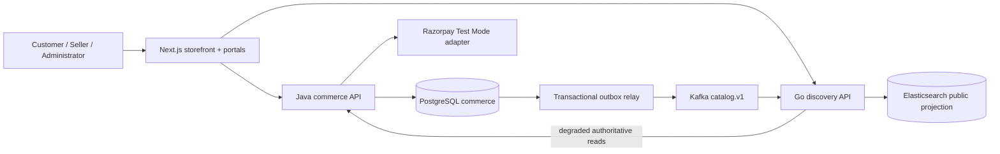

# Aangan marketplace: implementation baseline

## Evidence and scope
On 2026-10-25 the repository contained only `AGENTS.md` and `prompt.md`; no application, dependency lockfiles, tests, Git metadata, or infrastructure existed. The supplied prompt is the requirements source. No separately attached original master prompt was found. India, INR, physical goods, English, one region, and guest checkout are initial assumptions. Brand working name: Aangan (subject to trademark review).

First milestone: seller submits an offer → administrator approves → durable catalog event → search projection → customer selects a product → server revalidates offered price and reserves stock → controlled provider capture → exactly one confirmed order. Local seeded identities and simulated capture are explicitly development-only. Real identity and Razorpay Test Mode remain release gates.

## Product baseline and dependency backlog
| Priority | Capability | Acceptance gate |
|---|---|---|
| P0.1 | Catalog, offers, moderation, inventory, discovery | Seller isolation; approved products visible; replay-safe projection |
| P0.2 | Guest checkout, price snapshot, reservation, payment, order | No overselling; idempotent checkout; verified capture; interrupted payment recovery |
| P0.3 | OIDC accounts, addresses, durable multi-item carts, merging | Customer ownership; secure sessions; cart merge policy |
| P0.4 | Fulfillment, cancellations, returns, refunds | Authorized transitions; refund ceiling; provider reconciliation |
| P0.5 | Double-entry journal, commissions, settlements | Balanced entries; immutable corrections; provider report reconciliation |
| P0.6 | Observability, security, accessibility, deployment | Test evidence, restore drill, staging approval and rollout |
| P1 | Reviews, promotions, lookbooks, PWA, richer search, analytics | Privacy, accessibility and measured performance |
| P2 | Passkeys, AI, AR, omnichannel, multi-region | Validated business case and operational capacity |

## Context and containers

Java owns canonical products, seller offers, stock, reservations, checkout, payment attempts and order transitions in one deployment initially. This avoids a distributed stock/payment transaction while business rules mature. Framework-free rules sit behind application use cases; JDBC and provider code are adapters. Go owns discovery projection and read composition, with no commerce DB access. It is a bounded concurrent I/O workload, not a claim that Go is inherently faster. Next.js composes presentation and forwards secure sessions; it never computes authoritative totals. Each deployable owns its migrations and tests. Owners initially: commerce engineering (Java), discovery engineering (Go), experience engineering (Next.js), platform engineering (runtime).

Shared seller rows in commerce are scoped by authenticated principal, with server-derived seller membership. No caller-supplied seller ID is accepted for creation. RLS is deferred until pooling/background-job tests exist. Production OIDC, privileged MFA and service identities are mandatory before external exposure. Development identities are loopback-only credentials, never a production authentication design.

## Transaction and state design
Money is integer INR paise. Prices include tax for the initial fixture; shipping is zero and is shown explicitly. No invented tax rate or delivery promise. Checkout includes an expected unit price; a mismatch returns conflict and requires customer review. Single-offer checkout is the first bounded slice; multi-seller carts are a follow-up.

Offer: DRAFT → PUBLISHED (administrator only). Stock: on_hand, reserved; available = on_hand − reserved. Reservation has a 15-minute expiry. A database row lock and SQL checks enforce nonnegative stock. Checkout: PENDING → CONFIRMED, EXPIRED, or REVIEW. Provider creation failure/unknown outcome remains PENDING and cannot trigger blind recreation. Capture after expiry goes to REVIEW without committing stock or confirming an order. An operator refund/reconciliation workflow is required before release. Browser callbacks can verify signatures but never confirm capture alone.

Idempotency scope is customer + key, with a database uniqueness constraint; the same key with a different offer/quantity/expected price is conflict. Records persist with orders (no automatic deletion in this slice). Provider order IDs and payment IDs are unique. Capture, stock commitment and confirmation outbox insertion share one DB transaction. Duplicate verified capture is a no-op; mismatched amount/currency/provider order is rejected. Outbox is at-least-once, partitioned by offer ID; full snapshots carry a monotonic version. Elasticsearch external version checks make duplicate and reordered publication safe. Poison events must halt consumption visibly rather than be acknowledged and lost; a bounded retry/DLQ operator workflow remains a hardening task.

## AWS target (not provisioned)
One Mumbai-region environment, CloudFront/S3 for public assets, ALB/WAF → ECS Fargate tasks in private subnets, RDS PostgreSQL Multi-AZ for production, Secrets Manager/KMS, least-privilege task roles. Elasticsearch hosting procurement is unresolved; use Elastic-managed service if approved. Compare provisioned MSK with managed Kafka cost before activation. Redis is deferred until there is a measured cache workload; never introduce an unused cache. EKS is deferred because no Kubernetes-specific requirement offsets operating cost.

| Well-Architected pillar | Planned control | Evidence required before release |
|---|---|---|
| Operations | Structured logs, readiness, correlation, runbooks, safe rollout | Trace purchase; inject failure; rollback rehearsal |
| Security | OIDC/MFA, tenant authorization, secret references, SBOM/scans | Isolation suite and threat-model review |
| Reliability | Outbox, reconciliation, PITR, timeouts | Restore drill; proposed RPO 15m/RTO 4h approval |
| Performance | CDN assets, bounded search, SQL indexes, pool limits | Mobile LCP ≤2.5s, INP ≤200ms, CLS ≤0.1; load profile |
| Cost | Fargate before EKS, staging schedules, quotas | Region-specific cost estimate and budget approval |
| Sustainability | Efficient assets, bounded retention, no idle extras | Resource and payload measurements, no environmental claims |

## Principal risks
No provider credentials or cloud authorization supplied. No real seller KYC, tax/invoice policy, shipping serviceability, return policy, commission agreement, fraud controls, or privacy/retention approval. These are consequential product decisions, not invented constants. Local fixtures are not a launch catalog. Full production readiness cannot be claimed from this initial milestone.
