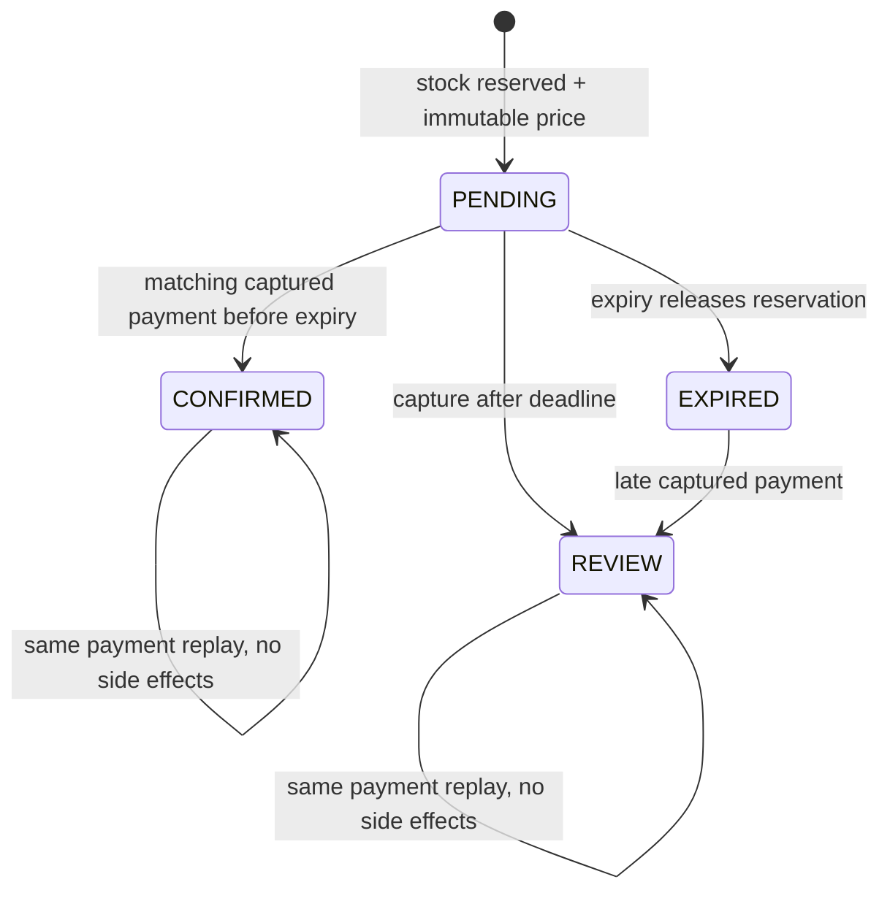

# First purchase slice: persistence and failure boundaries

```mermaid
sequenceDiagram
  actor Buyer
  participant Web as Next.js BFF
  participant Java as Commerce
  participant DB as PostgreSQL
  participant Pay as Payment adapter
  participant Kafka
  participant Search as Go / Elasticsearch
  Buyer->>Web: Establish guest session (HttpOnly cookie)
  Buyer->>Web: Explicit reserve with stable idempotency key
  Web->>Java: Signed customer identity + expected price + quantity
  Java->>DB: Transaction: serialize key, lock offer, validate stock/price
  Java->>DB: Reserve + checkout snapshot + catalog outbox
  DB-->>Java: Commit
  Java->>Pay: Create provider order from stored total
  alt Known order
    Pay-->>Java: Provider order ID
    Java->>DB: Persist provider order / READY
  else Unknown outcome
    Java->>DB: Persist UNKNOWN (no blind recreation)
  end
  Java-->>Web: Persisted pending checkout
  Web-->>Buyer: Reference and pending status
  Buyer->>Pay: Explicit test payment / controlled simulation
  Pay->>Java: Verified capture through adapter
  Java->>DB: Lock checkout; compare order ID, INR amount, state
  alt Active reservation
    Java->>DB: Commit stock, CONFIRMED, audit and order/catalog outbox
  else Expired reservation
    Java->>DB: REVIEW, no confirmed order or stock commitment
  end
  Java->>Kafka: Outbox relay (at least once)
  Kafka->>Search: Public versioned offer snapshot
  Search->>Search: External version guard; then commit consumer offset
  Buyer->>Web: Reload checkout reference
  Web->>Java: Authorized read
  Java-->>Buyer: Current persisted state
```

The controlled simulation endpoint calls the same capture transition as the provider adapter; it is not evidence of a real Razorpay transaction. Signed callbacks fetch provider state before capture handling. The webhook uses raw-body verification and durable event deduplication. Late captures require a subsequent refund/reconciliation operations slice.



Within PENDING, provider state is CREATING, READY or UNKNOWN. Capture sets CAPTURED. These provider substates do not independently authorize fulfillment. Cancel/refund/fulfillment states are not implemented yet.
